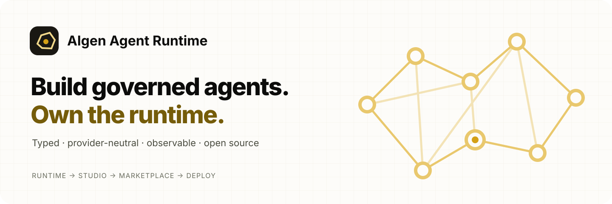

<picture>
  <source media="(prefers-color-scheme: dark)" srcset="https://raw.githubusercontent.com/AlgenAI/algen-agent-runtime/refs/heads/main/docs/assets/brand/banner-dark.svg">
  <source media="(prefers-color-scheme: light)" srcset="https://raw.githubusercontent.com/AlgenAI/algen-agent-runtime/refs/heads/main/docs/assets/brand/banner-light.svg">
  
</picture>

# Algen Agent Runtime

[](https://github.com/AlgenAI/algen-agent-runtime/actions/workflows/quality.yml)
[](https://github.com/AlgenAI/algen-agent-runtime/actions/workflows/security.yml)
[](https://www.python.org/downloads/)
[](https://github.com/AlgenAI/algen-agent-runtime/blob/main/LICENSE)
[](https://pypistats.org/packages/algen-agent-runtime)

Algen Agent Runtime is a typed, provider-neutral Python runtime for building governed AI agents. Approvals, policies, budgets and tenant boundaries are enforced in the execution path, not asked for in a prompt; every run is checkpointed, recoverable and observable. Use it as a library or as a REST/SSE service, with any model provider.

> [!IMPORTANT]
> The `0.2` betas lead to `0.2.0` and then `1.0`. The supported deployment is a single node (one Runtime process per database); running several processes on one database is experimental. Read the [production readiness](https://github.com/AlgenAI/algen-agent-runtime/blob/main/docs/production-readiness.md) scope and the [threat model](https://github.com/AlgenAI/algen-agent-runtime/blob/main/docs/threat-model.md) before deploying.

**[Documentation](https://algenai.github.io/algen-agent-runtime/)** · [Getting started](https://github.com/AlgenAI/algen-agent-runtime/blob/main/docs/getting-started.md) · [Why use it](https://github.com/AlgenAI/algen-agent-runtime/blob/main/docs/why-algen-agent-runtime.md) · [Examples](https://github.com/AlgenAI/algen-agent-runtime/blob/main/algen_agent_runtime_examples/README.md) · [Changelog](https://github.com/AlgenAI/algen-agent-runtime/blob/main/CHANGELOG.md)

## See it in one minute

No API key and no network: the built-in mock provider stands in for the model.

```bash
python -m pip install --pre algen-agent-runtime
python -m algen_agent_runtime_examples.quickstart_approval.app
```

The workflow proposes a change, then pauses at an approval node and asks `Approve or reject?`.
Approve it and the change is applied once, under an idempotency key; reject it and nothing is
written. The final state records the decision, who made it, and the key:


The approval is part of the Runtime's execution path, so the model cannot skip it.

## What you get

- **Governance in the execution path**: policies at every boundary, human approvals and an
  approval inbox, budgets, PII and secret redaction (streamed text included), tenant and user
  isolation.
- **Any model provider**: OpenAI, Azure OpenAI, Anthropic, Gemini, xAI, Groq, Mistral, DeepSeek,
  Hugging Face, Ollama and any OpenAI-compatible endpoint, with routing and fallback.
- **Governed tools**: typed schemas, permissions, approvals enforced at execution, an
  idempotency ledger that reconciles unknown outcomes; MCP servers with per-user OAuth.
- **Durable and recoverable**: checkpointed runs, conversations, multi-agent workflows (DAGs with
  fan-out, approvals and child workflows), artifacts and events on PostgreSQL and Redis; crash
  recovery and graceful drain.
- **Observable**: OpenTelemetry traces and metrics, Grafana dashboards, Prometheus alerts and
  single-node SLOs, with telemetry tested free of credentials.
- **Offline-testable**: a deterministic mock provider runs everything without keys or network.

The full list is in [Getting started](https://github.com/AlgenAI/algen-agent-runtime/blob/main/docs/getting-started.md#capabilities).
Ready-made connectors (email, messaging, databases, documents, GitHub) ship separately in
[algen-agent-tools](https://github.com/AlgenAI/algen-agent-tools).

## Install

```bash
python -m pip install --pre algen-agent-runtime              # the library
python -m pip install --pre 'algen-agent-runtime[service]'   # plus the HTTP API and OTLP export
```

Extras add PostgreSQL, Redis, auth, MCP and framework adapters (`[postgres,redis,auth]`, `[mcp]`,
`[langgraph]`, ...); see [Install](https://github.com/AlgenAI/algen-agent-runtime/blob/main/docs/getting-started.md#install).
Python 3.12 and 3.13.

## Quickstart

Scaffold a project and run it offline:

```bash
algen-agent-runtime new my-agent --template agent   # or --template approval, workflow
cd my-agent
python app.py
pytest
```

Or embed the Runtime in your own code:

```python
import asyncio

from algen_agent_runtime.config.settings import AppSettings
from algen_agent_runtime.orchestration.container import build_container
from algen_agent_runtime.runtime.client import AlgenAgentRuntimeClient
from algen_agent_runtime.types.contracts import RunRequest

settings = AppSettings.model_validate(
    {
        "providers": {"mock": {"type": "mock", "default_model": "deterministic"}},
        "agents": [
            {
                "name": "hello",
                "version": "1.0.0",
                "description": "Offline quickstart agent",
                "system_instructions": "Answer concisely.",
                "default_model": {"name": "default", "provider": "mock", "model": "deterministic"},
            }
        ],
    }
)


async def main() -> None:
    container = build_container(settings)
    try:
        result = await AlgenAgentRuntimeClient(container.runtime).run(
            RunRequest(agent="hello", input="Hello", tenant_id="quickstart", user_id="local-user")
        )
        print(result.output)  # Hello
    finally:
        await container.aclose()


asyncio.run(main())
```

Next: a [multi-agent workflow](https://github.com/AlgenAI/algen-agent-runtime/blob/main/docs/getting-started.md#multi-agent-dag-workflow),
[the HTTP service](https://github.com/AlgenAI/algen-agent-runtime/blob/main/docs/getting-started.md#run-the-http-service),
a [real local model](https://github.com/AlgenAI/algen-agent-runtime/blob/main/algen_agent_runtime_examples/quickstart_local_chat/README.md),
and the [examples](https://github.com/AlgenAI/algen-agent-runtime/blob/main/algen_agent_runtime_examples/README.md), each runnable offline.

## Documentation

- [Getting started](https://github.com/AlgenAI/algen-agent-runtime/blob/main/docs/getting-started.md): install, quickstarts, CLI, HTTP service, architecture, every guide
- [Operations](https://github.com/AlgenAI/algen-agent-runtime/blob/main/docs/operations.md): deployment, configuration, security, recovery, SLOs and runbooks, measured performance
- [Embedding the Runtime in an application](https://github.com/AlgenAI/algen-agent-runtime/blob/main/docs/conversations.md): conversations, streaming, approvals, cancellation
- [Writing tools](https://github.com/AlgenAI/algen-agent-runtime/blob/main/docs/tool-authoring.md), [MCP](https://github.com/AlgenAI/algen-agent-runtime/blob/main/docs/mcp.md) and [multi-agent workflows](https://github.com/AlgenAI/algen-agent-runtime/blob/main/docs/multi-agent-workflows.md)
- [API stability](https://github.com/AlgenAI/algen-agent-runtime/blob/main/docs/api-stability.md), [upgrading from 0.1](https://github.com/AlgenAI/algen-agent-runtime/blob/main/docs/upgrading.md) and the [road to 1.0](https://github.com/AlgenAI/algen-agent-runtime/blob/main/docs/ga-criteria.md)

## AI coding skills

The package ships skills that teach coding agents the current Runtime contracts. Install the copy
that matches your Runtime with `algen-agent-runtime skills install --path .` (into
`.agents/skills/`; `--skills-dir .claude/skills` for Claude Code):

- `algen-agent-builder`: Studio-importable single-agent and multi-agent projects;
- `algen-agent-connector`: APIs, MCP, databases, retrieval, memory and telemetry, governed;
- `algen-runtime-host`: applications that embed the Runtime (chat UIs, run following, approval
  inboxes, metering, storage) without rebuilding what it already does;
- `algen-runtime-extension`: providers, tools, stores, retrieval, telemetry and framework adapters.

This repository also has `algen-runtime-contributor` and `algen-external-pr-review` for work on the
Runtime itself. More in [Getting started](https://github.com/AlgenAI/algen-agent-runtime/blob/main/docs/getting-started.md#ai-coding-skills).

## Contributing, security and license

Contributions are welcome: see [CONTRIBUTING.md](https://github.com/AlgenAI/algen-agent-runtime/blob/main/CONTRIBUTING.md)
(DCO sign-off, tests against real PostgreSQL and Redis) and [GOVERNANCE.md](https://github.com/AlgenAI/algen-agent-runtime/blob/main/GOVERNANCE.md).
Community support is best effort ([SUPPORT.md](https://github.com/AlgenAI/algen-agent-runtime/blob/main/SUPPORT.md)).

Report vulnerabilities privately, never in a public issue, as [SECURITY.md](https://github.com/AlgenAI/algen-agent-runtime/blob/main/SECURITY.md) describes.

Licensed under the [Apache License 2.0](https://github.com/AlgenAI/algen-agent-runtime/blob/main/LICENSE); see [NOTICE](https://github.com/AlgenAI/algen-agent-runtime/blob/main/NOTICE).
