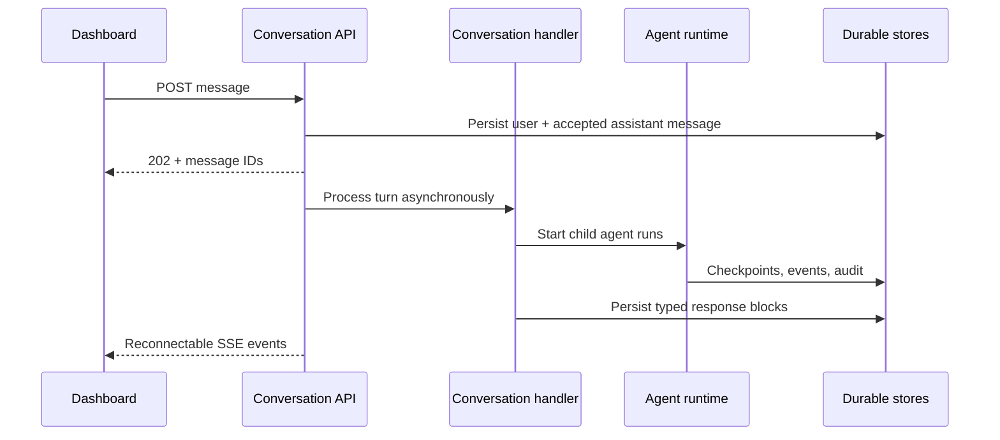
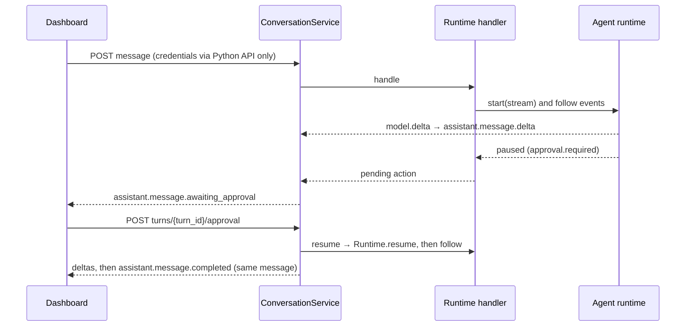
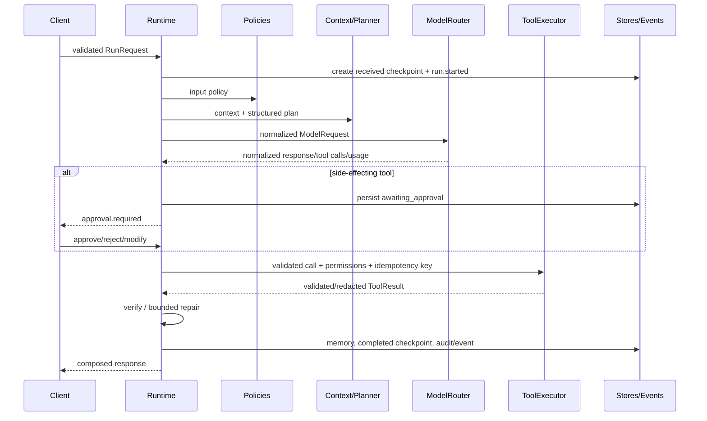

# Architecture and key decisions

## Conversation application boundary

Algen Agent Runtime exposes a generic durable conversation layer above individual runs. A conversation
handler maps a user turn to one or more child agent runs and returns presentation-neutral content
blocks. Conversation, message, event, run, parent-run, workflow-run, tenant, and user identifiers are
preserved independently, so a UI session is not conflated with a model invocation.



Handlers are plugins: the core has no analytics, SQL, or dashboard-specific behavior. Interrupted
conversation responses are marked retryable rather than automatically replayed, because a generic
handler may own externally visible side effects whose idempotency is unknown.

A turn can stream and pause. The built-in `runtime` handler starts its run with `stream` when every
model the agent may use can stream, and forwards the run's `model.delta` events as coalesced
`assistant.message.delta` conversation events. When the run pauses for an approval or a
clarification, the turn returns a `pending` action; the service stores it on the assistant message
(`awaiting_approval` or `awaiting_input`) and refuses new messages until the turn is answered or
cancelled. `ConversationService.respond` (and the `.../turns/{turn_id}/approval|input` routes)
applies the answer with `Runtime.resume` and follows the same run into the same assistant message.
Because the pending action lives in the conversation store and the paused run in the run store, a
restart loses neither and nothing re-runs: recovery leaves paused turns waiting and only follows or
settles runs that already moved on. A handler opts in by implementing
`ResumableConversationHandler` (`resume`, `follow`, `settle`, `pending_state`, `cancel_pending`).



## Boundaries

`types` owns normalized contracts. `runtime` owns legal transitions and termination. `planning`, `context`, `policies`, `verification`, `responses`, and `tools` are independent strategies. `models/providers`, `persistence`, and `api` are adapters. `orchestration/container.py` is the only default composition root.

### Context assembly and packing

The default and retrieval context builders load session memory once into `RunState.context_history`.
Model-facing `messages` are a separate projection: packing never deletes retained history. Runtime
can opt into archive-backed checkpoints, retaining an absolute offset, protected messages, and the
uncompacted tail after each successful compaction archive write. Source recovery then depends on
artifact retention and the governed archive reader. Compaction thresholds adapt to builder and
configured model budgets, including protected working state and skill projections.
Runtime appends user clarifications, model responses, tool results, and repair instructions through
`RunState.append_message()` to update both views. `memory_policy.enabled: false` or `max_items: 0`
disables loading prior session history; the current run still retains its execution transcript.
Retrieved evidence remains a fresh builder input rather than being appended repeatedly to history.

Packing preserves system messages, the latest user message, and the newest message group. An
assistant tool-call message and its tool results form one group, including partially executed
parallel calls. Older groups are retained from newest to oldest until the next group no longer fits.
Orphan tool results raise `ConflictError`; required context that cannot fit raises
`BudgetExceededError` rather than silently dropping instructions or exceeding the configured bound.

The default limit is 16,000 estimated tokens. Applications can replace the registered default builder:

```python
from algen_agent_runtime.context.builder import DefaultContextBuilder

runtime.contexts.register(DefaultContextBuilder(runtime.memory, max_estimated_tokens=24_000))
```

The dependency-free estimate includes serialized message content, tool arguments, and metadata.
It is not a provider tokenizer or a guarantee about image/file token costs, tool definitions, output
headroom, or a model's context window. Packing selects an active view; the underlying history remains
inline or in the configured archive chain. [Recoverable compaction](artifacts.md#recoverable-history-compaction) can
replace older message groups in that view with a summary and a source archive. Custom context builders
remain responsible for their own packing behavior and do not opt into built-in compaction.

The model router additionally applies [per-profile context budgets](providers.md#model-context-budgets)
when `context_window_tokens` is configured. Before each provider dispatch it reserves the requested
output limit, tool/schema overhead, and a safety margin, then packs a candidate-specific view. This
also covers retries, validation repairs, streaming dispatch, and fallback to smaller models. Each
candidate starts with the original request; packing never mutates that request or the run state.
This second check cannot restore history already removed by a context builder.

Opt-in [tool-result offloading](artifacts.md#offloaded-tool-context) stores processed payloads before
context assembly and replaces them with bounded references. Read-back is an explicitly enabled,
permissioned tool scoped to the originating run and user. The model-facing view can be small while
the original processed tool result remains in the execution record and artifact store.

Opt-in [structured working state](context-management.md) keeps goals and task progress separately
from history summaries. Built-in builders insert a bounded, protected assistant projection of the
current revision. Governed updates persist in run checkpoints and follow existing write-approval
policies; they do not establish authorization or carry automatically into other runs.

Opt-in [progressive skills](skills.md) advertise permitted descriptions first and load selected
guidance through `core.skills_load`. Catalogs and active guidance have separate budgets, remain
protected during packing, and never grant tool permissions. Accepted selections persist separately
from canonical history, with source identity and authorization checked again during recovery.

Opt-in [learned memory](learned-memory.md) stores explicitly selected facts and procedures separately
from session transcripts. Records are scoped to tenant, user, and agent name. Governed tools recall
content on demand and apply versioned corrections/deletes through atomic replay-safe stores.

Key decisions:

1. Runs use optimistic versioning. A resume or worker may update only the checkpoint version it loaded.
2. Side-effecting calls carry `run_id:tool_call_id` idempotency keys. Approval and a tool-execution
   reservation persist before execution. Completed results are replayable; interrupted side effects
   become indeterminate and require reconciliation: a tool's `reconcile` hook or an operator
   settles them through `ToolReconciliation` (compare-and-set on the ledger status), and a tool's
   `compensation` runs only on an operator's request. The ledger is written before the run
   checkpoint, and replay of a completed call returns its recorded result, so the two need no
   shared transaction (see operations.md, "Resolving indeterminate tool calls").
3. Plans are strict models with unique IDs and backward-only dependencies. The runtime executes only registered action kinds, enabled tools, and allowed models.
4. Capability discovery happens before routing. Unhealthy, disallowed, or incapable models are excluded; the router then uses quality and observed latency.
5. Paused states are durable. Active asyncio tasks are an optimization, not the durable source of
   truth. Agent turns recover on startup. Multi-agent workflows checkpoint each lifecycle transition,
   bind recovery to a manifest fingerprint, attribute first-class human approval decisions, and
   replay only nodes explicitly declared retry-safe. Exact-version child workflows have independent
   checkpoints linked by parent/root IDs; the parent records child identity before dispatch and
   reconciles that checkpoint after failure instead of creating a duplicate;
   analytical graphs additionally support PostgreSQL checkpoints and lease-based distributed claims.
6. Core storage defaults to isolated in-memory adapters. PostgreSQL can persist every execution
   record; Redis provides checkpoints and expiring session memory. Production artifacts can keep
   lifecycle metadata in PostgreSQL while encrypted bytes live in S3-compatible object storage;
   scanners transition pending content through a provider-neutral, audited compare-and-set service.
7. Diagnostic logs and immutable audit contracts are separate. Both pass through redaction before export.
8. Observability uses OpenTelemetry contracts. Standard OTLP is built in; the optional Traccia adapter owns only SDK lifecycle and per-run agent identity, leaving runtime instrumentation vendor-neutral.
9. RAG is a composition of `DocumentIndexer`, `Retriever`, `RetrievalContextBuilder`, and citation-verification contracts. Tenant filtering happens before ranking, retrieved content is marked as untrusted data, and vector-store adapters remain outside orchestration.
10. Caching is a port, not a provider assumption. In-memory and Redis adapters implement the same
    contract. Policies select global, tenant, user, session, or run scope independently for model
    capabilities, retrieval, exact model responses, and safe tool results. Only hashed identity and
    request material enter keys. Cache failures are fail-open; side-effecting tools are never cached.
11. Analytical orchestration is a separate typed DAG. Node outputs remain individually addressable;
    method/model-service/query-governance/evaluation contracts are domain-neutral, while formulas and
    model implementations are registered by applications.
12. Query permission is distinct from model permission. Source trust, purpose, metric/column access,
    workload quotas, fingerprints, exports and cache scope are checked before the database, whose RLS
    and grants remain authoritative.

See [Analytical Runtime](analytical-runtime.md) for the graph and extension contracts.

## Execution flow



## Configuration precedence

Built-in defaults are merged with YAML files, `ALGEN_AGENT_RUNTIME__` nested environment variables, and deployment overrides. Agent and request settings are resolved by orchestration; request overrides are strict and should be allowlisted by deployments. Unknown fields fail validation.
